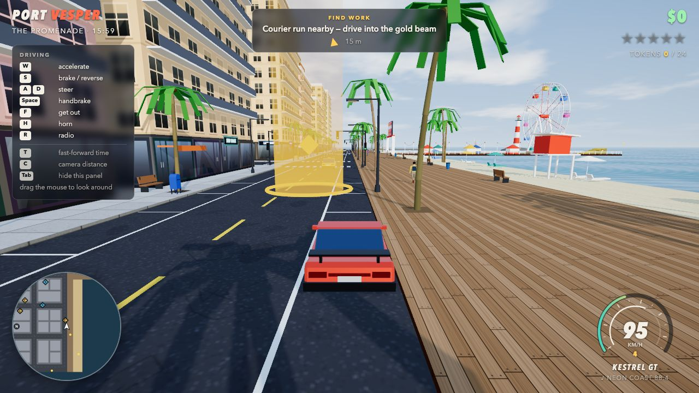
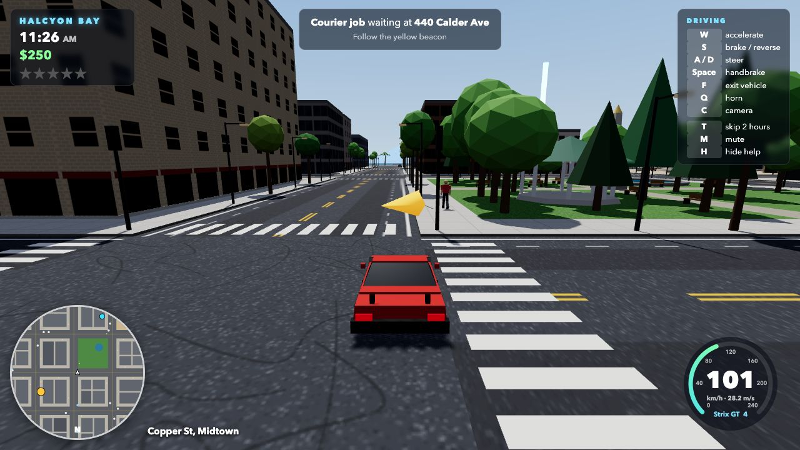
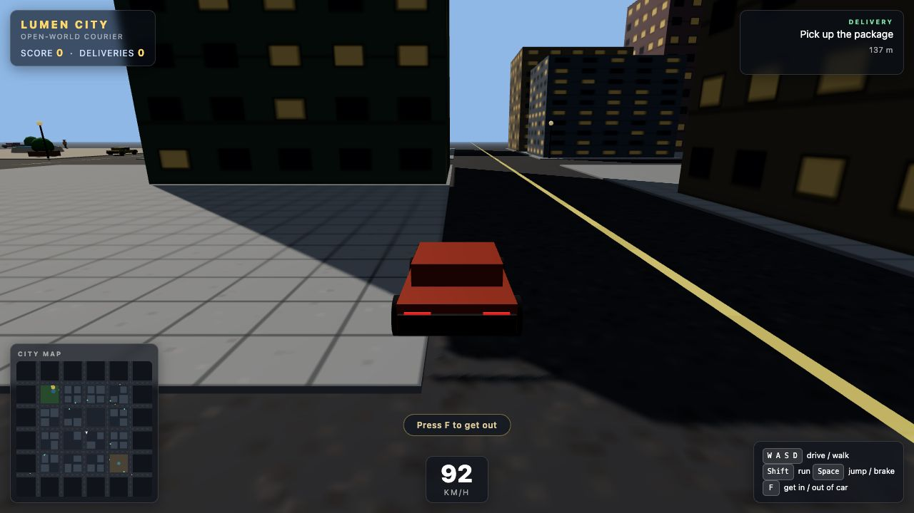

# GTA7 Bench

How good a small open-world 3D game can a model build in one unattended session?

Every model gets the same folder and the same brief ([kit/TASK.md](kit/TASK.md)): build an
original miniature city sandbox in the browser where you walk around, get into cars and
drive, using only Three.js and code. Each one works alone in an agent harness, then the
results are play-tested by a script and reviewed by a judge.

## Results (22 November 2026, one run each)

| Model | Game | Score | Play-test | Features | Build time | Lines |
|---|---|---|---|---|---|---|
| Claude Fable 5.2 (high effort) | Port Vesper | 92 | 30 | 62 | 77 min | 6,182 |
| Claude Opus 5.5 (high effort) | Halcyon Bay | 86 | 30 | 56 | 38 min | 4,053 |
| Inkling 2 Mini (local, 4-bit) | Lumen City | 60 | 30 | 30 | 203 min | 2,007 |

| Port Vesper | Halcyon Bay | Lumen City |
|---|---|---|
| [](results/fable-5.2/gameplay.mp4) | [](results/opus-5.5/gameplay.mp4) | [](results/inkling-2-mini/gameplay.mp4) |

Click a picture for a gameplay video of that entry (no sound). The full report with
screenshots, videos and the reasoning behind each score is `results/index.html`;
`results/report-standalone.html` is the same page as one file, without the videos.

## Layout

| Path | What it is |
|---|---|
| `kit/` | The starting folder each model receives: the brief, Three.js, and a test tool. |
| `runs/<model>/` | What each model built. Open `index.html` through a local server to play. |
| `harness/score.mjs` | The automated play-test: ten checks, identical for every entry. |
| `harness/record.mjs` | Records a gameplay video of each entry by driving a route with the keyboard. |
| `harness/report.mjs` | Builds the comparison report from the scores in `results/`. |
| `harness/serve-inkling.sh` | Serves Inkling 2 Mini locally with llama.cpp. |
| `harness/run-inkling.sh` | Runs the task on Inkling with Claude Code as the harness. |
| `results/` | Scores, screenshots, gameplay videos and the comparison report. |
| `logs/` | Raw session transcripts. Kept locally, not in git. |

## Scoring (100 points)

- **Play-test, 30 points.** Ten scripted checks worth 3 each: it loads cleanly, draws a
  scene, exposes the test hook, F enters the car, W drives, D steers, F exits, W walks, it
  holds 30 fps, and it survives a longer session.
- **Features, 70 points.** Seven areas from the brief, 10 each: city, on-foot character,
  vehicles, living world, HUD, something to do, atmosphere. Scored by a judge who plays the
  game and reads the code.

## Running it

```sh
npm install                      # Three.js (copied into kit/) and puppeteer-core
cp -R kit runs/<model>           # give a model its starting folder
node harness/score.mjs           # play-test every entry in runs/
node harness/record.mjs          # record results/<model>/gameplay.mp4 (needs ffmpeg)
node harness/report.mjs          # build results/index.html from the scores
python3 -m http.server 8000      # then open localhost:8000/results/ or /runs/<model>/
```

Needs Google Chrome for the play-test. Inkling needs about 30 GB of free memory.
